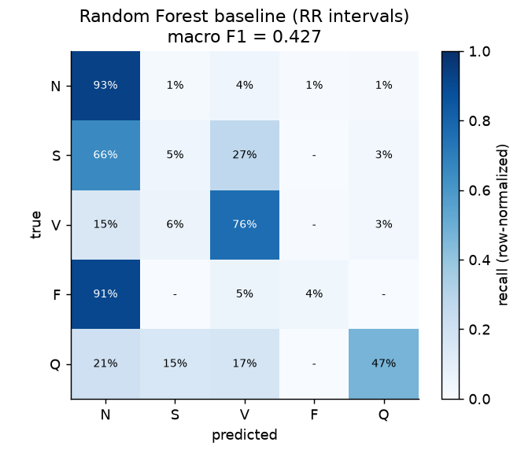
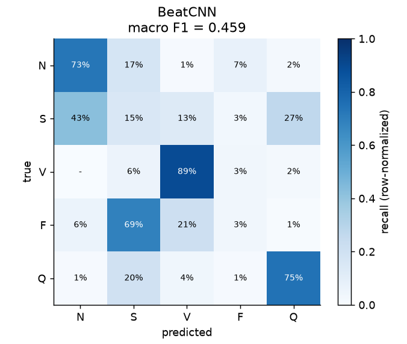
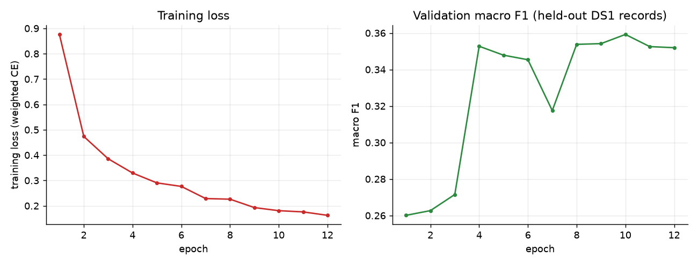
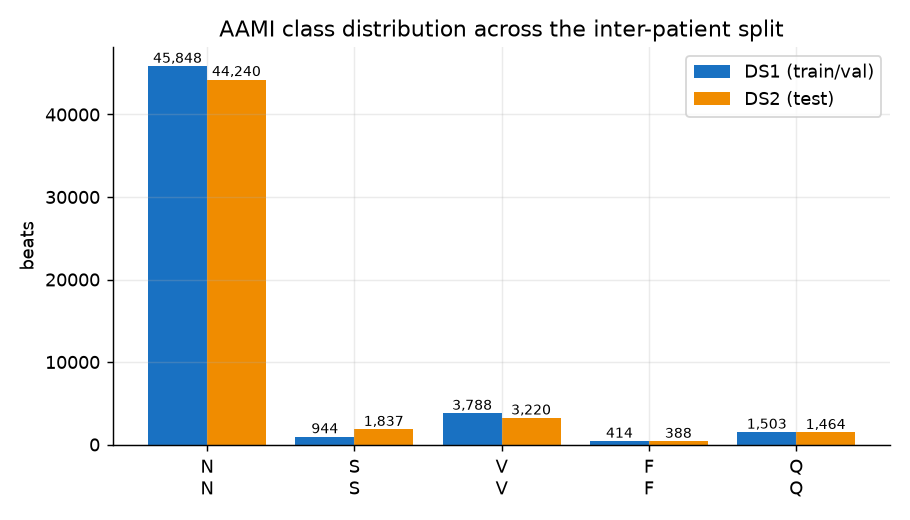
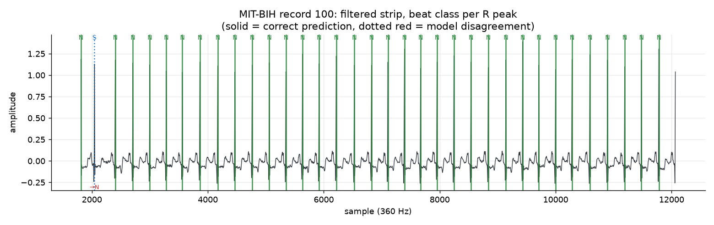
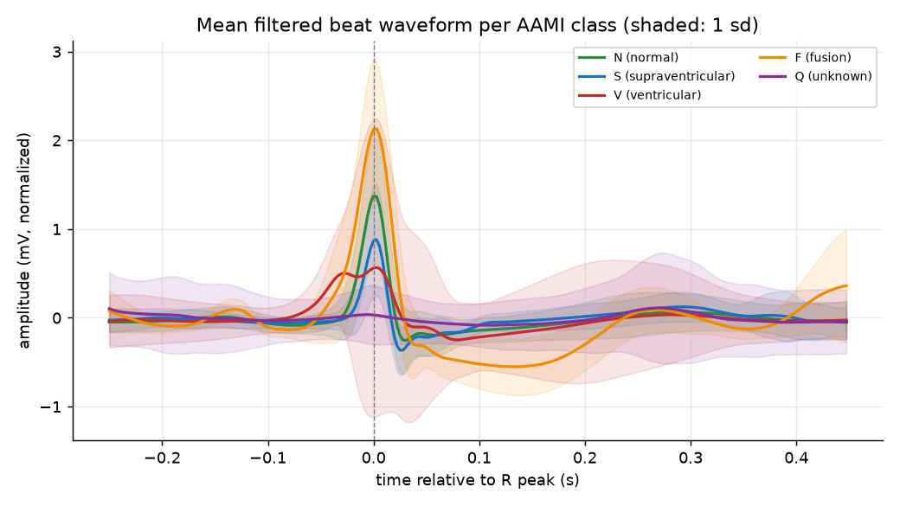
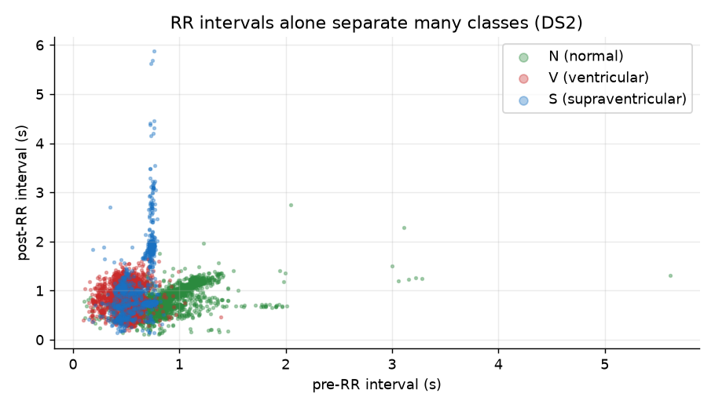

# ECG Arrhythmia Detection

Heartbeat-level arrhythmia classification on the **PhysioNet MIT-BIH Arrhythmia
Database**, using an **honest inter-patient split** and two models compared on
the same test patients: a classical Random-Forest baseline over RR-interval
features, and a 1D CNN over the raw beat waveform plus those RR features.

The point of the project is methodological: report metrics that cannot be
inflated by leakage, on patients the models have never seen.

---

## Headline result

| Model | Macro recall | Macro precision | Macro F1 |
| --- | --- | --- | --- |
| RandomForest (RR intervals) | 0.4490 | 0.4186 | 0.4269 |
| **BeatCNN (1D CNN + RR)** | **0.5101** | 0.4502 | **0.4588** |

Evaluated on **51,149 held-out DS2 beats** from 22 patients never used in
training. Full per-class numbers: [results/cnn_metrics.json](results/cnn_metrics.json),
[results/baseline_metrics.json](results/baseline_metrics.json); the cross-model
comparison table (Markdown + CSV) is generated into
[results/results_table.md](results/results_table.md) and
[results/results_table.csv](results/results_table.csv).

Per-class breakdown — `support` is the number of DS2 beats in the class:

| Class | Support | Baseline recall | Baseline F1 | CNN recall | CNN F1 |
| --- | --- | --- | --- | --- | --- |
| `N` normal | 44,240 | **0.9304** | **0.9382** | 0.7297 | 0.8347 |
| `S` supraventricular | 1,837 | 0.0468 | 0.0593 | **0.1502** | **0.0529** |
| `V` ventricular | 3,220 | 0.7618 | 0.6015 | **0.8916** | **0.8369** |
| `F` fusion | 388 | **0.0361** | **0.0383** | 0.0335 | 0.0069 |
| `Q` unknown | 1,464 | 0.4699 | 0.4975 | **0.7452** | **0.5625** |





The CNN gains ~3.2 macro-F1 points over the RR baseline, but the per-class
numbers show it is not a uniform win: it **buys** recall on the arrhythmic
classes (V +13 pts, Q +28 pts, S roughly 3×) by **selling** `N` recall down
~20 pts (0.93 → 0.73) — about 8,800 true-normal beats get re-labelled as
arrhythmic. That is the expected price of a minority-heavy loss, and it is why
bare accuracy would fall even though macro-F1 rises.

Both numbers are low in absolute terms, and that is expected and reported
honestly: MIT-BIH's five AAMI classes are dominated by `N` (normal), the
arrhythmic classes are tiny and noisy, and macro-F1 weights all five classes
equally. `Q` (unknown/paced-ectopic leftovers) and `F` (fusion, 388 beats) are
the main drag on both models — `F` recall is near-zero in both, and no amount of
tuning fixes a class with 388 test beats.

---

## The dataset

- **Source:** PhysioNet MIT-BIH Arrhythmia Database — 48 half-hour ECG records,
  47 patients, sampled at 360 Hz, two channels (usually MLII, modified lead II).
- **Fetched at runtime** with `wfdb` directly from PhysioNet; no manual download,
  no bundled binaries.
- **Excluded records:** 102, 104, 107, 217 (paced), following de Chazal et al.,
  because pacing morphology is out of scope for a beat-classifier.
- **Classes (AAMI five-way):** `N` normal, `S` supraventricular ectopic,
  `V` ventricular ectopic, `F` fusion, `Q` unknown. Every annotation symbol is
  mapped through a table and anything unmapped lands in `Q` rather than being
  silently dropped.

## Honest evaluation — why this matters more than the score

1. **Inter-patient split (DS1 / DS2).** DS1 (records 101, 106, 108, 109, 112,
   114, 115, 116, 118, 119, 122, 124, 201, 203, 205, 207, 208, 209, 215, 220,
   223, 230) is train-only; DS2 is test-only. **No patient appears on both
   sides.** Random beat-level splits leak patient-identity signal and inflate
   scores by a wide margin — that is the single most common failure mode in
   published MIT-BIH results.
2. **No beat-level shuffling across the split.** Beats are extracted once, then
   partitioned by record, not by beat index.
3. **Metrics:** per-class precision/recall/F1, macro averages, and a full
   confusion matrix. Bare accuracy is never reported — on MIT-BIH accuracy is
   ~88% from predicting `N` for everything.
4. **Class weighting** in both models, because `N` is ~88% of beats and an
   unweighted classifier degenerates to predicting the majority class.

## Pipeline

```
PhysioNet (MIT-BIH)            raw records + beat annotations
        |  download.py  (wfdb, record whitelist)
        v
filter + resample check        preprocess.py  (band-pass / baseline handling)
        |  data.py  (map_aami, R-peak windows: -0.25 s / +0.45 s => 252 samples)
        v
features.py  (RR intervals, prev/next RR, local RR stats)
        |
        +--> baseline.py   RandomForest on RR features
        |
        +--> models.py     1D CNN (BeatCNN) over the 252-sample waveform,
               train.py     concatenated with the same RR features,
                             weighted cross-entropy, early stop on val macro-F1
        v
evaluate.py       per-class + macro metrics, confusion matrix
visualize.py      figures
results_table.py  cross-model comparison table (CSV + Markdown)
```

**Beat windows** are cut around each annotated R peak — 0.25 s before, 0.45 s
after — giving 252 samples at 360 Hz. Windows that overhang the record edges are
dropped, and the kept beat indices are carried through so per-beat RR features
stay aligned with the waveform.

**Training:** weighted cross-entropy, Adam, batch 256, early stopping on DS1
validation macro-F1. The CNN ran 12 epochs with validation early-stopping,
~1,289 s on CPU. Best validation macro-F1 was 0.3592; test macro-F1 0.4588.
(The test set is larger and easier; the held-out validation split is drawn from
the same 22 DS1 patients as training, which is also why both numbers are
modest.)



## Figures

All in [results/figures/](results/figures), all produced by
`python -m ecg_arrhythmia.visualize` and committed to this repository:

### The class imbalance that motivates class weighting

**Class distribution** — `N` is 44,240 of 51,149 beats (~86.5%) and `F` has only 388. This is the imbalance that motivates class weighting in both models:



Without weighting, both models collapse toward predicting `N` everywhere and still score ~86% accuracy — which is exactly why bare accuracy is never reported here.

### Raw-signal sanity check



A straight `wfdb` read of one record before any preprocessing. Used to confirm
the download, the 360 Hz sampling and the annotation alignment are all correct
before beats get cut.

### What the CNN sees



Per-class mean beat shape after the −0.25 s / +0.45 s window cut. The widened,
notched `Q` and the sharp `V` shapes are the morphology signal the 1D CNN
exploits — and the reason it beats the RR-only baseline on `V`.

### What the baseline sees



RR-interval distributions per class. This is the *only* signal the
RandomForest receives — enough for a coarse heartbeat-rate story, and not enough
to separate `S` from `F` or `V`, which is visible in its per-class numbers above.

### Training


Loss falls monotonically; validation macro-F1 plateaus around 0.35 after
epoch 10, which is where early stopping picks the checkpoint (best 0.3592).

### Where the two models disagree


Rows are true class, columns predicted. Reading the two side by side: the
baseline massed ~1,700 true `V` beats into `N` with high `N` recall, while the
CNN moved most of them back to `V` (recall 0.89, F1 0.84) at the cost of
roughly 8,800 true `N` beats leaking into `S`.

## Layout

```
src/ecg_arrhythmia/
  config.py        paths, constants, AAMI class list, DS1/DS2 record lists
  download.py      PhysioNet fetch via wfdb (excludes paced records)
  preprocess.py    signal conditioning
  data.py          annotation -> AAMI mapping, beat-window extraction
  features.py      RR-interval features
  models.py        BeatCNN (1D CNN + RR head)
  baseline.py      RandomForest baseline
  train.py         training loop, seeding, standardisation, early stopping
  evaluate.py      metrics + confusion matrix
  visualize.py     all figures
  results_table.py cross-model comparison table (CSV + Markdown)
tests/             unit tests (pure numpy/scipy, no torch, no network)
.github/workflows/ ci.yml  (test job + torch import-smoke job)
requirements.txt   full deps; requirements-smoke.txt for the test suite alone
notes.md           chronological decisions, data bugs, honesty rules
```

## Results artefacts

| File | Contents |
| --- | --- |
| [results/results_table.md](results/results_table.md) | Cross-model macro comparison (Markdown) |
| [results/results_table.csv](results/results_table.csv) | Same table, machine-readable |
| [results/cnn_metrics.json](results/cnn_metrics.json) | BeatCNN per-class metrics, confusion matrix, training metadata |
| [results/baseline_metrics.json](results/baseline_metrics.json) | RandomForest per-class metrics and confusion matrix |
| [results/train_history.json](results/train_history.json) | Per-epoch train loss and validation macro-F1 |
| [results/figures/](results/figures) | All seven figures shown above |

## Reproduce

```bash
python -m venv .venv && source .venv/bin/activate   # Windows: .venv\Scripts\activate
pip install -r requirements.txt
pip install -e .

# fetch data from PhysioNet (network required)
python -m ecg_arrhythmia.download

# baseline
python -m ecg_arrhythmia.baseline
# CNN (CPU-runnable, ~20 min)
python -m ecg_arrhythmia.train
# figures + comparison table
python -m ecg_arrhythmia.visualize
python -m ecg_arrhythmia.results_table
```

Tests (no network, no torch, ~15 s):

```bash
pip install -r requirements-smoke.txt
pytest -q
ruff check src tests
```

## Tests and CI

`tests/test_ecg_pipeline.py` covers the parts that actually break: AAMI symbol
mapping including the unknown-symbol fallback, beat-window boundary dropping and
index alignment, RR-feature construction order, signal filtering shape/DC
removal, split integrity (no shared records between DS1/DS2), metric
computation on a hand-checked confusion matrix, and reproducibility of seeding.

CI runs two jobs: a `test` job (pytest + ruff, minimal deps) and a `smoke` job
(CPU torch, imports every module to catch API drift).

## Known limitations

- Macro-F1 is ~0.46; this is a legitimate, reproducible result on the hard
  five-way task, not a tuned state-of-the-art number.
- The CNN's `N` recall (0.73) is *worse* than the baseline's (0.93), so despite
  the better macro-F1 it produces far more false positives on normal beats. If
  the deployment goal were "don't miss arrhythmias", `V` recall 0.89 with
  precision 0.79 is the number to look at, not macro-F1.
- `F` (fusion) and `V` are severely under-represented; per-class recall for them
  is poor and visible in the confusion matrices.
- Only lead MLII is used; the second channel is ignored.
- The model is a research artefact, **not a medical device** and not validated
  for clinical use.

## Credits / references

- Moody & Mark, *The impact of the MIT-BIH Arrhythmia Database*, IEEE Eng in
  Med & Biol, 2001.
- de Chazal, O'Dwyer & Reilly, *Automatic classification of heartbeats using
  ECG morphology and heartbeat interval features*, IEEE TBME, 2004 (source of
  the DS1/DS2 split and the paced-record exclusion list used here).- ANSI/AAMI EC57 standard for the five-way beat-class nomenclature.

